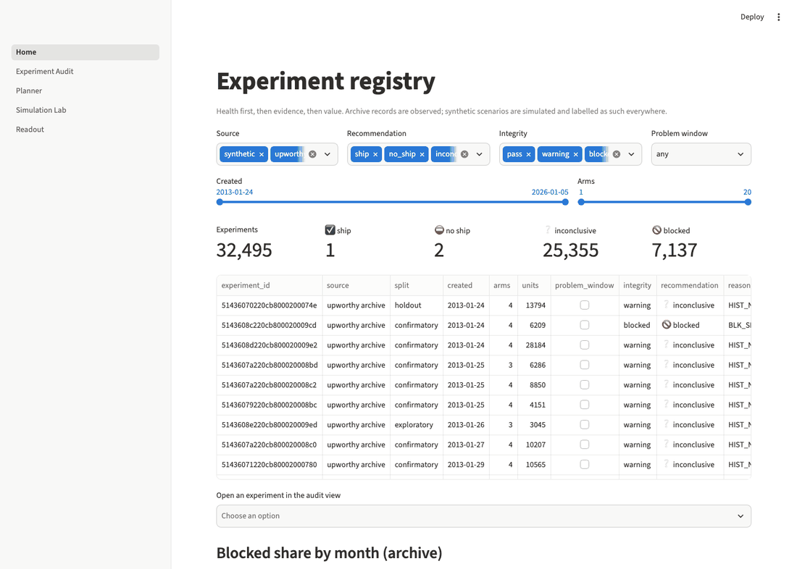
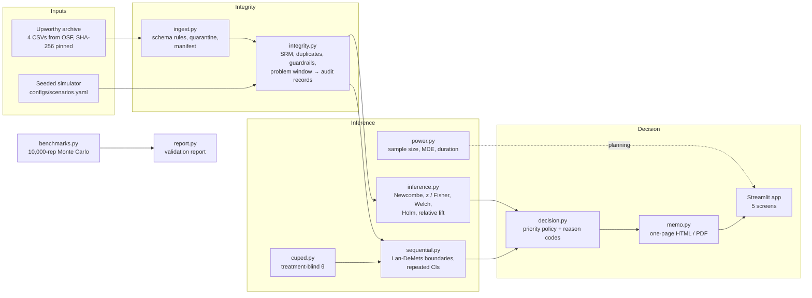
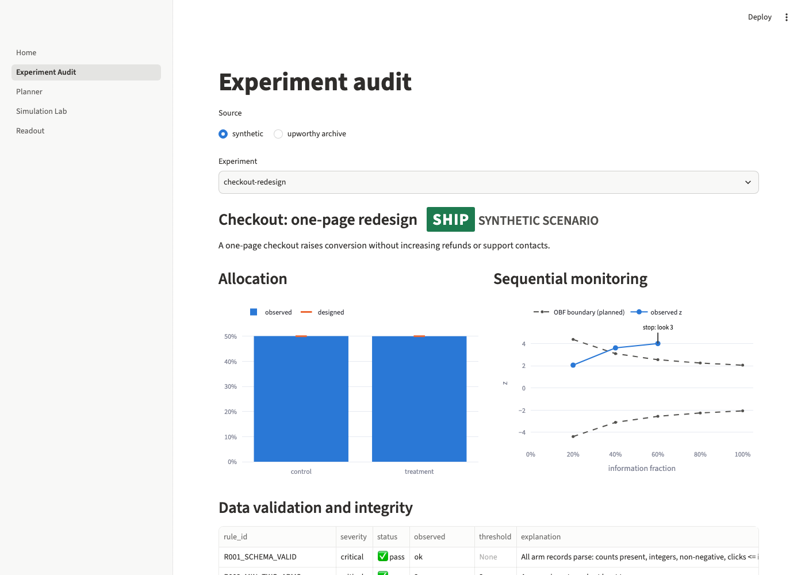
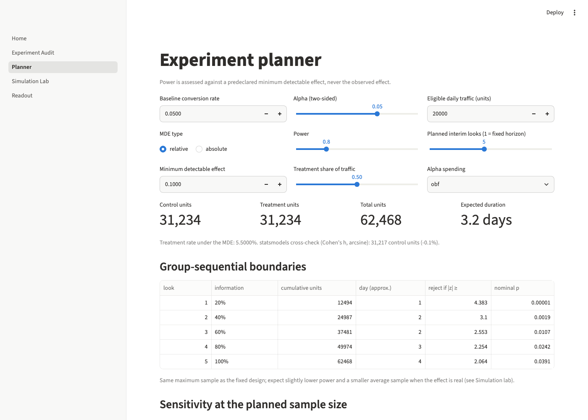
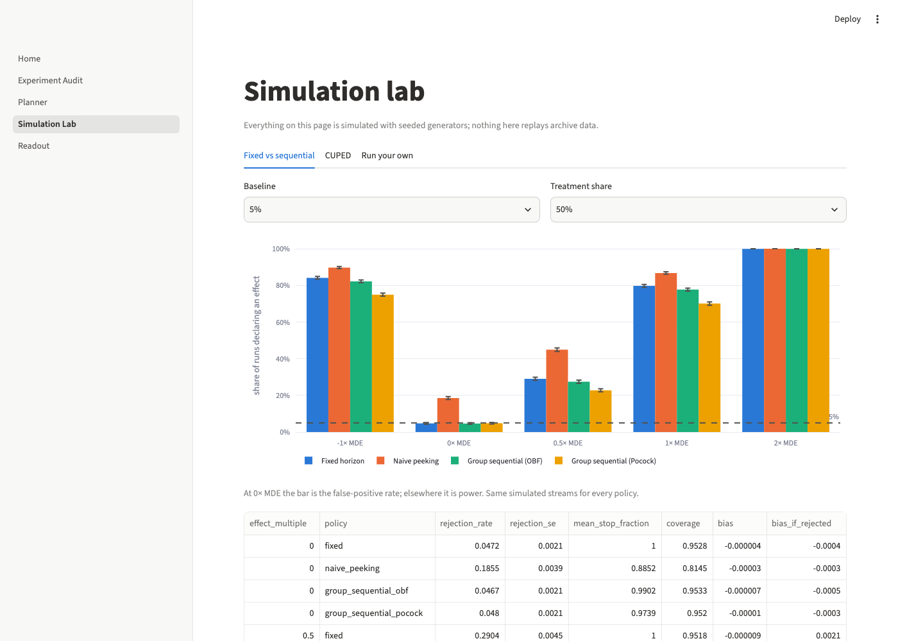

# Experiment Decision Engine

An A/B-test audit and readout system that checks experiment health before evidence, and evidence before value.
It audits all 32,487 deployed tests in a real public experiment archive, benchmarks fixed-horizon, peeking and
group-sequential designs and CUPED on seeded simulations, and turns validated results into deterministic
ship / no ship / inconclusive / blocked readouts with reason codes and a full decision trace.

Project page: [omkar-ku1karni.github.io/experiment-engine](https://omkar-ku1karni.github.io/experiment-engine/)

The design goal is to avoid the usual trap: a dashboard that turns `p < 0.05` into a green "ship" label. Here an
invalid experiment can never ship. A statistically significant but commercially trivial lift is not shipped. A
winning primary metric with a harmful guardrail is a no ship.



## Results

| | |
|---|---|
| Archive tests accounted for | 32,487 of 32,487 published deployed tests (plus 18,508 undeployed ids, 54,211 quarantined rows and 57 orphan rows, each with a reason) |
| SRM failure rate inside vs outside the documented randomization-problem window | 69.8% vs 0.47%. SRM recovers the documented start and end dates *to the week* |
| Median CTR lift an archive test could detect at 80% power | 72% (fewer than 0.1% of tests could detect a 20% lift) |
| False-positive rate: naive peeking (10 looks) vs Lan-DeMets O'Brien-Fleming | 19.4% vs 4.97% (nominal 5%, 10,000 reps x 6 designs, simulated) |
| Average sample used by group-sequential monitoring when the effect equals the MDE | 76% of the fixed plan, at 77.9% power vs 80.0% |
| CUPED variance ratio at ρ = 0.58 | 0.655 ± 0.007 (theory 0.664): about 34% fewer units for equal power, no detectable bias |
| Tests | 65 passing: unit, archive fixtures, decision-policy properties, synthetic scenarios, all 5 UI screens |

Full numbers with Monte Carlo errors: [reports/validation_report.md](reports/validation_report.md).
Example one-page memos: [ship](reports/memos/checkout-redesign.pdf) *
[no ship, tiny lift](reports/memos/search-ranking-v2.pdf), [no ship, guardrail harm](reports/memos/recs-carousel.pdf) *
[inconclusive](reports/memos/pricing-page-copy.pdf), [blocked, SRM](reports/memos/onboarding-checklist.pdf) *
[archive readout](reports/memos/archive-readout-5143605e22.pdf), [archive blocked](reports/memos/archive-blocked-5143606122.pdf).

## Architecture



Every persisted result carries a content-addressed `run_id` (config hash + input checksums + engine version). Re-running
on the same inputs reproduces the same id and the same outputs.

## Quick start

Requires Python 3.11–3.12 and [uv](https://docs.astral.sh/uv/). No API keys needed.

```bash
git clone https://github.com/omkar-ku1karni/experiment-engine.git && cd experiment-engine
make all      # install, download + verify archive (~128 MB), ingest, audit, simulate, scenarios, memos, report (~70 s after download)
make test     # 65 tests
make demo     # Streamlit app on http://localhost:8501
```

Optional extras: `make browsers` (headless Chromium) enables `make memos-pdf` and `make screenshots`. `make help`
lists every target. A `Dockerfile` is included. It builds in CI but was not run locally (Docker isn't set up on
the development Mac).

## The app

| Registry | Experiment audit |
|---|---|
|  |  |
| Planner | Simulation lab |
|  |  |

- Registry: filter by source, recommendation, integrity, date, arm count and problem window; run history.
- Experiment audit: allocation vs design, CTR or metric intervals, the sequential monitoring path, rule-level
  integrity records, comparisons, reason codes and the decision trace.
- Planner: sample size, duration and a power curve at fixed n, plus group-sequential boundaries. The design
  exports as YAML or JSON.
- Simulation lab: benchmark explorer, plus live seeded runs for sequential and CUPED.
- Readout: the one-page memo ([screenshot](reports/screenshots/5_readout.png)), downloadable as HTML or PDF.

## Data

Upworthy Research Archive (Matias, Munger, Le Quere & Ebersole, 2021,
[Scientific Data](https://doi.org/10.1038/s41597-021-00934-7)), CC BY 4.0, downloaded from
[OSF jd64p](https://osf.io/jd64p/) and verified against the SHA-256 values in `configs/archive.yaml`. Raw files are not
committed. They are downloaded by `make download`.

- The exploratory (4,873), confirmatory (22,743) and holdout (4,871) splits sum to exactly the published 32,487.
  The undeployed export (18,514 ids, 6 shared with deployed tests) is ingested and excluded with reasons.
- Randomization-problem flag. The 2024 archive update added a column marking tests with unreliable randomization
  (documented as `problem`, also written `randomization_imbalace_risk`), but the OSF files predate it. The flag is
  reconstructed from the documented rule (first package created 2013-06-25 to 2014-01-10) and stored as
  `problem_reconstructed`. It marks 21.6% of tests, which matches the archive's own "22%".
- pandas' CSV parser silently drops 57 multi-line records in the undeployed file. Ingestion reads with DuckDB and
  checks the record count against Python's `csv` module.

### Data dictionary

| Entity (grain) | File | Key fields |
|---|---|---|
| experiment (one test) | `data/processed/experiments.parquet` | `experiment_id`, `source`, `split`, `experiment_date`, `n_arms_source/valid`, `impressions`, `clicks`, `expected_allocation` (assumed equal), `control_definition` (null: not recorded), `reference_arm_id` (predeclared exploratory rule), `primary_metric`, `alpha`/`planned_horizon`/`mde` (null: not recorded), `analysis_mode`, `problem_reconstructed`, `period`, `included`, `exclusion_reason` |
| arm (one package) | `data/processed/arms.parquet` | `arm_id`, `experiment_id`, `split`, `impressions`, `clicks`, `created_at`, `headline`, `eyecatcher_id`, raw values, `row_valid`, `row_issues`, `arm_included`, `arm_exclusion`, `source_file`, `source_row` |
| quarantine | `data/processed/quarantine.parquet` | malformed rows with raw values and reason codes |
| manifest | `data/processed/manifest.json` | source URLs, SHA-256, bytes, rows, distinct ids, schema, ingestion time, counts |
| user_outcome (one unit; synthetic) | `data/synthetic/<id>.parquet` | `experiment_id`, `unit_id`, `arm_id`, `assigned_at`, `pre_period_metric`, `conversion`, `revenue`, guardrails (`refund_rate`, `support_contact_rate`), `source = synthetic` |
| audit_result (one check) | `data/runs/<run>/audit_results.parquet` | `run_id`, `experiment_id`, `rule_id`, `severity`, `status`, `observed`, `threshold`, `explanation` |
| decision (one analysis version) | `data/runs/<run>/decisions.parquet` | `run_id`, `experiment_id`, `metric`, `effect`, `ci_low/high`, `p_value`, `integrity_status`, `recommendation`, `reason_codes`, `trace`, `config_hash`, `engine_version` |

## Methods

| Problem | Method |
|---|---|
| Sample ratio mismatch | Chi-square goodness of fit (df = k - 1), gate p < 0.001; Monte Carlo multinomial test when any expected count < 5 |
| Binary metrics | Difference in proportions; pooled z-test, or Fisher's exact test when any expected cell < 5; Newcombe hybrid-score interval |
| Relative lift | (p₁ - p₀)/p₀ with a Katz log-ratio interval; flagged undefined when the control rate is 0 |
| Revenue per user | Welch's t-test including zeros, with a percentile-bootstrap sensitivity check |
| Multiple arms (archive) | No control is recorded, so every arm is compared to the earliest-created package (predeclared, labelled exploratory); Holm-adjusted p-values, Bonferroni simultaneous intervals, omnibus homogeneity test |
| Planning | Closed-form sample size for any allocation, cross-checked against statsmodels (within 2%) and simulation; MDE at fixed n; duration |
| Sequential monitoring | Lan-DeMets O'Brien-Fleming / Pocock spending, boundaries by numerical integration (matches gsDesign to 4 decimals); repeated confidence intervals at the stopping look |
| Variance reduction | CUPED with a pooled, treatment-blind θ; missing covariates set to the mean; zero-variance covariates fall back to raw |

## Decision policy

Rules are applied in priority order and the first match wins. Every evaluated rule is written to the trace with a stable reason code.

| Priority | State | Rule | Reason codes |
|---|---|---|---|
| 1 | Blocked | Critical integrity failure (schema, < 2 arms, SRM, duplicate assignment, documented randomization problem) or no valid estimate | `BLK_*` |
| 2 | No ship | A guardrail shows significant harm beyond its margin, or the primary interval's upper bound < δ | `NS_GUARDRAIL_HARM:<name>`, `NS_UPPER_BELOW_DELTA` |
| 3 | Ship | Primary repeated-CI lower bound > 0 and estimate >= δ (configurable: `lcb_ge_delta`), and every required guardrail is non-inferior (interval upper bound < margin) | `SHIP_*` |
| 4 | Inconclusive | Everything else: insufficient evidence, missing δ, missing or uncertain guardrail | `INC_*` |

Archive records get a historical statistical readout that is always non-actionable (`HIST_NO_CONTROL`,
`HIST_NO_COMMERCIAL_THRESHOLD`, `HIST_NO_GUARDRAILS`, plus `EVID_*`). Synthetic product experiments are monitored
over 5 planned looks. They stop for efficacy only once every required guardrail is resolved, since stopping earlier
would leave guardrails underpowered.

## Validation matrix

| Case | Expected | Where it is demonstrated |
|---|---|---|
| 50/50 A/A; valid 70/30 allocation | Calibrated error; 70/30 not flagged | `simulations/results/{fixed,srm}.csv`, scenario `aa-70-30`, `tests/test_integrity.py` |
| Injected 60/40 under 50/50 | SRM flags; decision blocked | scenario `onboarding-checklist`, fixture `t_srm`, SRM benchmark (~100% detection) |
| Missing control or guardrails | Historical readout / no actionable ship | every archive record; scenario `cart-reminder-email` |
| Sparse / zero clicks | No division by zero; exact test or flag | fixture `t_zero`, `tests/test_inference.py` |
| Correlated pre-treatment feature | Lower variance, unbiased | CUPED benchmark, `tests/test_cuped.py` |
| 10 interim looks | Naive vs calibrated on identical streams | sequential benchmark, `tests/test_sequential.py` |
| Positive but tiny lift | No ship or inconclusive | scenario `search-ranking-v2` (significant in some seeds, never shipped) |
| Meaningful lift + harmful guardrail | No ship | scenario `recs-carousel` |
| Invalid data | Quarantined, never shipped | fixtures `t_badrow`, `t_badtime`, `t_single`; property test over 2,000 random cases |

## Evidence boundary and limitations

- Observed: archive CTRs, impression allocation, SRM and sensitivity. Simulated: everything sequential, CUPED,
  revenue, guardrails and product decisions. Simulations are never presented as historical replays, and the archive
  holds no interim looks, covariates, revenue or guardrails.
- The archive records no planned allocation, so SRM assumes equal allocation. The post-fix SRM rate (0.24%, near the
  0.1% gate) supports that assumption, and the pre-window rate (2.8%) suggests some milder early imbalance.
- The randomization-problem flag is reconstructed from documentation, not read from the corrected release.
- Sensitivity analysis describes what each archive test *could* detect; it makes no claim about whether the original design was adequate.
- Early efficacy stops overstate effects (winner's curse). Readouts report repeated CIs, and the benchmark quantifies the bias.
- The decision policy's false-ship rate under the null is about 2.5% (the one-sided α of the efficacy boundary). The
  A/A scenario shows this across seeds.

## Repository layout

```
configs/     archive.yaml (source + checksums), policy.yaml, scenarios.yaml, benchmark.yaml
src/expengine/
  ingest.py  integrity.py  inference.py  power.py  cuped.py  sequential.py
  simulation.py  benchmarks.py  product.py  audit.py  decision.py  memo.py  report.py  templates/
app/         Streamlit: Home.py (registry) + pages/ (audit, planner, simulation lab, readout)
simulations/results/   benchmark tables (CSV) + meta.json
reports/     validation_report.md, figures/, memos/, screenshots/, demo.gif
tests/       65 tests + tiny synthetic archive fixtures (scripts/make_fixtures.py)
```

## Credits

Data: J. Nathan Matias, Kevin Munger, Marianne Aubin Le Quere & Charles Ebersole, *The Upworthy Research Archive, a
time series of 32,487 experiments in U.S. media*, Scientific Data 8, 195 (2021), with the 2024 author correction. CUPED:
Deng, Xu, Kohavi & Walker (2013). Group-sequential methods: Jennison & Turnbull (2000); Lan & DeMets (1983).
