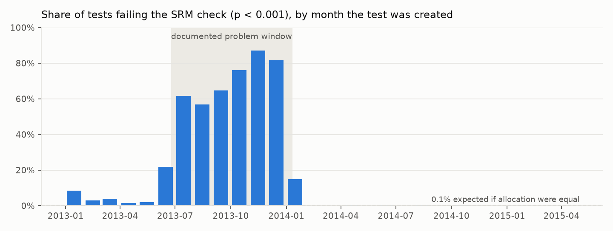
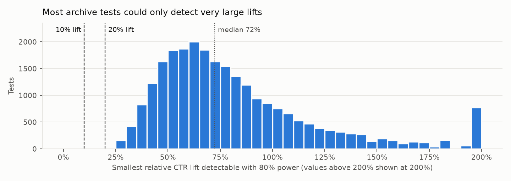
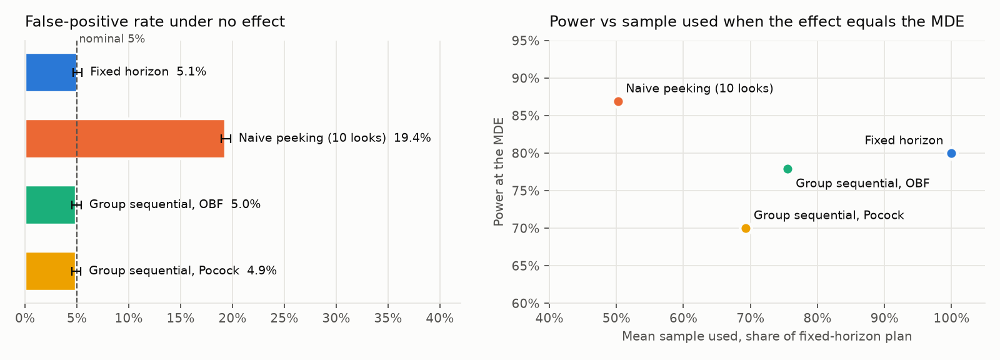
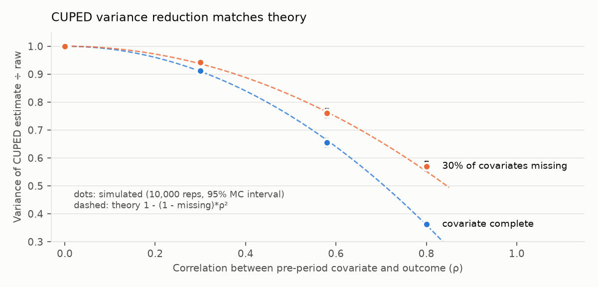

# Statistical validation report

Experiment Decision Engine. Generated by `make report` from persisted outputs; every number below is
read from `data/runs/`, `data/processed/` or `simulations/results/`.

**Headline numbers**

| | |
|---|---|
| Archive tests accounted for | 32,487 deployed of 32,487 published (plus 18,508 undeployed ids, all excluded with reasons) |
| SRM failure rate inside vs outside the documented randomization-problem window | 69.8% vs 0.47% |
| Median detectable lift (80% power) in archive tests | 72% |
| False-positive rate, naive peeking vs group sequential (simulated) | 19.4% vs 4.97% (nominal 5%) |
| Sample used by OBF group sequential at the MDE | 76% of fixed plan, power 77.9% vs 80.0% |
| CUPED variance ratio at ρ = 0.58 (simulated) | 0.655 ± 0.007 (theory 0.664) |

Evidence boundary: archive numbers are observed; sequential, CUPED and decision results are simulations
and are never presented as historical replays.

## 1. Historical archive audit (Upworthy Research Archive)

Run `archive-813a513967`, data: OSF `jd64p` (OSF jd64p, files uploaded 2021-05-03 (package exports dated 2020-03-12 and 2021-01-12)). The archive holds arm-level impressions and clicks only:
no user ids, timestamps of exposure, covariates, revenue or guardrails, so CUPED, sequential looks and
guardrail checks cannot be evaluated on it and are benchmarked on simulations instead (section 2).

### 1.1 Ingestion funnel: every source row and test id is accounted for

| Stage | Count |
|---|---|
| Source rows (4 files) | 229,049 |
| Distinct test ids across all files | 50,995 |
| Deployed tests (exploratory + confirmatory + holdout) | 32,487 (published benchmark 32,487: match) |
|   by split | confirmatory 22,743, exploratory 4,873, holdout 4,871 |
| Excluded: undeployed split | 18,508 |
| Excluded: fewer than two arms | 2 |
| Quarantined rows (missing counts, all in undeployed split) | 54,211 |
| Rows with no test id (undeployed split) | 57 |
| Test ids in more than one split | 6 |
| Analysable tests | 32,485 |
| Deployed tests in documented problem window (reconstructed flag) | 7,016 (21.6%; archive states ~22%) |

The 2024 archive update added a randomization-problem column, but the files on OSF predate it. The
flag is therefore reconstructed from the documented rule (tests created 2013-06-25 to
2014-01-10). It marks 21.6% of deployed tests, matching the
archive's own statement that about 22% of tests are affected.

### 1.2 SRM against the documented problem window

Each analysable test is checked against equal allocation across its packages (assumed; the archive does
not record the planned split) with a chi-square test at p < 0.001.

| Period | Tests | SRM flag rate (p<0.001) |
|---|---|---|
| Before 2013-06-25 | 2,305 | 2.78% ± 0.34% |
| 2013-06-25 to 2014-01-10 (documented) | 7,014 | 69.76% ± 0.55% |
| After 2014-01-10 | 23,166 | 0.24% ± 0.03% |

- Inside the documented window, 69.8% of tests fail SRM; outside it, 0.47%. After
  the fix the rate is 0.24%, close to the 0.1% expected from the test's own
  false-positive rate, which supports the equal-allocation assumption for that period.
- The flag and SRM disagree in both directions: 2,121 flagged tests show no detectable imbalance
  (smaller tests have less power to detect it) and 119 unflagged tests fail. This is a diagnostic
  comparison, not proof that every flagged test is broken or every unflagged test is valid.
- Finding: SRM independently recovers the documented dates to the week. The SRM rate jumps in the
  week the problem began and drops in the week it was fixed (monthly bars blur this because June 2013 and
  January 2014 straddle the boundaries):

| Week starting | Tests | SRM flag rate |
|---|---|---|
| 2013-05-06 | 122 | 0.8% |
| 2013-05-13 | 183 | 3.3% |
| 2013-05-20 | 67 | 3.0% |
| 2013-05-27 | 97 | 3.1% |
| 2013-06-03 | 190 | 3.7% |
| 2013-06-10 | 257 | 3.9% |
| 2013-06-17 | 214 | 3.3% |
| 2013-06-24 | 319 | 59.9% |
| 2013-07-01 | 229 | 61.1% |

| Week starting | Tests | SRM flag rate |
|---|---|---|
| 2013-12-23 | 44 | 56.8% |
| 2013-12-30 | 99 | 57.6% |
| 2014-01-06 | 193 | 51.8% |
| 2014-01-13 | 272 | 1.8% |
| 2014-01-20 | 204 | 1.0% |
| 2014-01-27 | 253 | 1.2% |

- Second finding: before the window the SRM rate is 2.8%, about
  28x the 0.1% expected under valid equal allocation (and
  12x the post-fix rate). Early-2013 tests may carry a milder imbalance the archive does not flag;
  they pass the documented-window rule but 64 of them are blocked here by SRM.

### 1.3 What the archive could detect (sensitivity, not design adequacy)

No MDE or planned sample size is recorded, so each test gets a sensitivity analysis: the smallest relative
CTR lift its reference arm and mean arm size could detect with 80% power at α = 0.05 (pairwise, unadjusted).

Median detectable lift: 72%. Only 7 of 25,339 tests (0.03%) could detect a 20% lift
and 0 a 10% lift; 17% could detect a 50% lift. Arm-to-reference differences remain after Holm adjustment in
36.0% of non-blocked tests: headline variants often differ a lot, so large effects are common.

### 1.4 Readouts

259,882 rule-level audit records were written. 7,135 tests are blocked (SRM, documented
randomization problem, or invalid structure) and 25,352 receive a historical, non-actionable readout:
there is no control, commercial threshold or guardrail, so no archive record can ever receive "ship".

## 2. Simulation benchmarks (seeded; all results are simulated)

10,000 replications per scenario (Monte Carlo SE of a 5% rate ~ 0.22%). Seed 20261124,
config hash `7f329fe14303`. Reproduce with `make simulate`.

### 2.1 Fixed-horizon inference: A/A calibration and interval coverage

Pooled z-test, with Fisher's exact test when any expected cell is below 5; Newcombe hybrid-score interval.

| Baseline | n per arm (nominal) | Treatment share | False-positive rate | Interval coverage | Fisher used |
|---|---|---|---|---|---|
| 1% | 200 | 50% | 0.62% ± 0.08% | 98.1% | 99% |
| 1% | 200 | 70% | 1.60% ± 0.13% | 98.4% | 100% |
| 1% | 2,000 | 50% | 4.54% ± 0.21% | 95.6% | 0% |
| 1% | 2,000 | 70% | 4.44% ± 0.21% | 95.7% | 0% |
| 1% | 20,000 | 50% | 5.01% ± 0.22% | 95.0% | 0% |
| 1% | 20,000 | 70% | 4.85% ± 0.21% | 95.2% | 0% |
| 5% | 200 | 50% | 5.24% ± 0.22% | 94.9% | 0% |
| 5% | 200 | 70% | 4.76% ± 0.21% | 95.5% | 21% |
| 5% | 2,000 | 50% | 5.08% ± 0.22% | 95.0% | 0% |
| 5% | 2,000 | 70% | 4.64% ± 0.21% | 95.4% | 0% |
| 5% | 20,000 | 50% | 4.81% ± 0.21% | 95.2% | 0% |
| 5% | 20,000 | 70% | 5.24% ± 0.22% | 94.8% | 0% |
| 20% | 200 | 50% | 5.07% ± 0.22% | 95.0% | 0% |
| 20% | 200 | 70% | 4.86% ± 0.22% | 95.2% | 0% |
| 20% | 2,000 | 50% | 4.91% ± 0.22% | 95.1% | 0% |
| 20% | 2,000 | 70% | 4.63% ± 0.21% | 95.4% | 0% |
| 20% | 20,000 | 50% | 4.90% ± 0.22% | 95.1% | 0% |
| 20% | 20,000 | 70% | 4.81% ± 0.21% | 95.2% | 0% |

Calibrated to nominal (within ±2 MC SE) except in the sparsest designs (1% baseline, 200 per arm), where
Fisher's exact test is conservative (false-positive rate 0.62%) and intervals over-cover:
the cost of exact inference with near-zero counts, reported rather than tuned away.

### 2.2 SRM check: false flags on valid designs, detection of broken ones

| Design | Units | Valid design | SRM flag rate |
|---|---|---|---|
| 50/50 valid | 1,000 | yes | 0.06% ± 0.02% |
| 50/50 valid | 10,000 | yes | 0.17% ± 0.04% |
| 50/50 valid | 100,000 | yes | 0.12% ± 0.03% |
| 70/30 valid | 1,000 | yes | 0.10% ± 0.03% |
| 70/30 valid | 10,000 | yes | 0.04% ± 0.02% |
| 70/30 valid | 100,000 | yes | 0.07% ± 0.03% |
| 4-arm equal valid | 1,000 | yes | 0.11% ± 0.03% |
| 4-arm equal valid | 10,000 | yes | 0.16% ± 0.04% |
| 4-arm equal valid | 100,000 | yes | 0.15% ± 0.04% |
| 60/40 under 50/50 | 1,000 | no | 99.83% ± 0.04% |
| 60/40 under 50/50 | 10,000 | no | 100.00% ± 0.00% |
| 60/40 under 50/50 | 100,000 | no | 100.00% ± 0.00% |
| 51/49 under 50/50 | 1,000 | no | 0.42% ± 0.06% |
| 51/49 under 50/50 | 10,000 | no | 9.89% ± 0.30% |
| 51/49 under 50/50 | 100,000 | no | 99.88% ± 0.03% |

Valid 50/50, 70/30 and 4-arm designs are flagged at about the 0.1% gate; an injected 60/40 split is caught
essentially always at 1,000+ units, while a subtle 51/49 split needs ~100,000 units.

### 2.3 Sequential monitoring: fixed vs naive peeking vs group sequential (paired streams)

Binary conversion; baselines 1%, 5%, 20%; allocations 50/50 and 70/30; 10 equally spaced looks; planned
sample size for a 10% relative MDE at 80% power. All policies see identical simulated streams.

| Policy | False-positive rate, null (mean [min–max] over 6 designs) | Power at MDE | Mean sample used at MDE | Coverage at stop (MDE) | Overestimate when significant |
|---|---|---|---|---|---|
| Fixed horizon | 5.06% [4.7%–5.5%] | 80.0% | 100% of planned | 95.0% | 12% |
| Naive peeking (10 looks) | 19.37% [18.6%–19.7%] | 86.9% | 50% of planned | 94.0% | 53% |
| Group sequential, OBF | 4.97% [4.7%–5.4%] | 77.9% | 76% of planned | 98.3% | 29% |
| Group sequential, Pocock | 4.93% [4.8%–5.1%] | 70.0% | 69% of planned | 98.6% | 55% |

- Naive peeking (stop at the first p < 0.05 across 10 looks) inflates the false-positive rate to 19.4%, about 3.9x nominal.
- Lan-DeMets O'Brien-Fleming keeps it at 4.97% while using 76% of the planned
  sample on average when the true effect equals the MDE, at 77.9% power vs 80.0% for the fixed design.
- Repeated confidence intervals keep (conservative) coverage at the stopping look; estimates from early
  stops overstate the effect, so readouts report the RCI rather than the naive interval.
- Effects of ½x, 2x and -1x MDE are in `simulations/results/sequential.csv` (120 rows).

### 2.4 CUPED variance reduction

Continuous outcome, 1,000 units per arm, θ fitted on the pooled sample (treatment-blind); missing
covariates set to the observed mean.

| ρ (latent) | Missing X | Variance ratio (sim) | Theory 1 - (1 - m)ρ² | Sample-size reduction | Bias under null (sd units) | False-positive rate | Coverage | Power raw -> CUPED (at raw MDE) |
|---|---|---|---|---|---|---|---|---|
| 0.0 | 0% | 1.000 ± 0.000 | 1.000 | 0.0% | -0.0004 ± 0.0004 | 4.85% | 95.2% | 79.9% -> 79.9% |
| 0.0 | 30% | 0.999 ± 0.000 | 1.000 | 0.1% | -0.0004 ± 0.0005 | 5.16% | 94.8% | 80.6% -> 80.5% |
| 0.3 | 0% | 0.912 ± 0.006 | 0.910 | 8.8% | -0.0003 ± 0.0004 | 5.01% | 95.0% | 79.5% -> 83.2% |
| 0.3 | 30% | 0.943 ± 0.005 | 0.937 | 5.7% | +0.0008 ± 0.0004 | 5.09% | 94.9% | 80.8% -> 83.3% |
| 0.58 | 0% | 0.655 ± 0.007 | 0.664 | 34.5% | -0.0002 ± 0.0004 | 4.91% | 95.1% | 79.9% -> 92.9% |
| 0.58 | 30% | 0.761 ± 0.008 | 0.765 | 23.9% | +0.0002 ± 0.0004 | 4.99% | 95.0% | 80.2% -> 89.7% |
| 0.8 | 0% | 0.362 ± 0.005 | 0.360 | 63.8% | +0.0003 ± 0.0003 | 5.37% | 94.6% | 79.8% -> 99.6% |
| 0.8 | 30% | 0.570 ± 0.008 | 0.552 | 43.0% | -0.0002 ± 0.0003 | 5.16% | 94.8% | 79.5% -> 96.5% |

At ρ = 0.58 the simulated variance ratio is 0.655 ± 0.007 (theory 0.664): a
35% smaller equivalent sample at equal power. No material bias under the null (all
|bias| within 2.5 MC SE) and coverage near 95%. Missing covariates shrink the gain in proportion to the missing share.

Binary conversion (latent correlation; realized point-biserial correlation is lower):

| ρ (latent) | Missing X | Realized corr(X, Y) | Variance ratio | Coverage |
|---|---|---|---|---|
| 0.0 | 0% | 0.001 | 0.999 | 95.2% |
| 0.0 | 30% | 0.002 | 1.000 | 95.0% |
| 0.3 | 0% | 0.209 | 0.952 | 94.7% |
| 0.3 | 30% | 0.209 | 0.971 | 95.3% |
| 0.58 | 0% | 0.405 | 0.836 | 94.8% |
| 0.58 | 30% | 0.406 | 0.877 | 94.8% |
| 0.8 | 0% | 0.558 | 0.681 | 94.9% |
| 0.8 | 30% | 0.558 | 0.789 | 94.9% |

## 3. Decision demonstrations (synthetic product experiments)

Run `synthetic-53ec76dab3`. Each scenario predeclares δ and guardrail margins in `configs/scenarios.yaml`; the
expected recommendation is asserted in `tests/test_product.py`. Robustness: re-running every scenario on 50
fresh seeds reproduces the documented recommendation in 44–50 of 50 runs; the A/A test "ships" in about
2.5% of seeds by construction (one-sided α of the efficacy boundary).

| Scenario (memo) | Primary | Effect [repeated 95% CI] | Stop look | Integrity | Recommendation | Reason codes |
|---|---|---|---|---|---|---|
| [checkout-redesign](memos/checkout-redesign.html) | revenue | +0.3012 [+0.1095, +0.4928] | 3/5 | pass | ship | `SHIP_PRIMARY_CLEARS_DELTA`, `SHIP_GUARDRAILS_NONINFERIOR` |
| [search-ranking-v2](memos/search-ranking-v2.html) | conversion | +0.0010 [-0.0006, +0.0026] | 5/5 | pass | no_ship | `NS_UPPER_BELOW_DELTA` |
| [recs-carousel](memos/recs-carousel.html) | revenue | +0.3102 [+0.0723, +0.5480] | 3/5 | pass | no_ship | `NS_GUARDRAIL_HARM:refund_rate` |
| [onboarding-checklist](memos/onboarding-checklist.html) | conversion | +0.0063 [+0.0020, +0.0105] | 5/5 | blocked | blocked | `BLK_SRM` |
| [referral-banner](memos/referral-banner.html) | revenue | +0.2258 [-0.0097, +0.4613] | 5/5 | blocked | blocked | `BLK_DUPLICATE_ASSIGNMENT` |
| [pricing-page-copy](memos/pricing-page-copy.html) | revenue | +0.2060 [-0.2583, +0.6703] | 5/5 | pass | inconclusive | `INC_INSUFFICIENT_EVIDENCE`, `INC_GUARDRAIL_UNCERTAIN:refund_rate`, `INC_GUARDRAIL_UNCERTAIN:support_contact_rate` |
| [cart-reminder-email](memos/cart-reminder-email.html) | revenue | +0.3592 [+0.2116, +0.5068] | 5/5 | warning | inconclusive | `INC_MISSING_GUARDRAIL:support_contact_rate` |
| [aa-70-30](memos/aa-70-30.html) | revenue | +0.1425 [-0.0788, +0.3638] | 5/5 | pass | inconclusive | `INC_INSUFFICIENT_EVIDENCE` |

Validation matrix coverage: valid 70/30 allocation not flagged (`aa-70-30`); injected 60/40 under 50/50 ->
blocked (`onboarding-checklist`); duplicate assignment -> blocked (`referral-banner`); positive but tiny lift ->
no ship (`search-ranking-v2`); meaningful lift + harmful guardrail -> no ship (`recs-carousel`); missing guardrail ->
not shipped (`cart-reminder-email`); underpowered -> inconclusive (`pricing-page-copy`). Archive examples:
`memos/archive-readout-*.html` (historical readout) and `memos/archive-blocked-*.html` (SRM).
